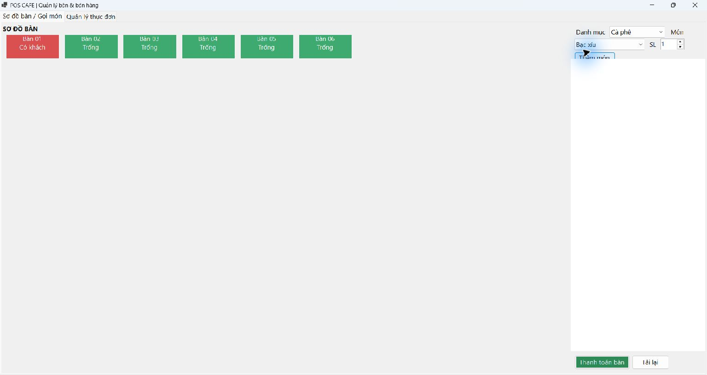
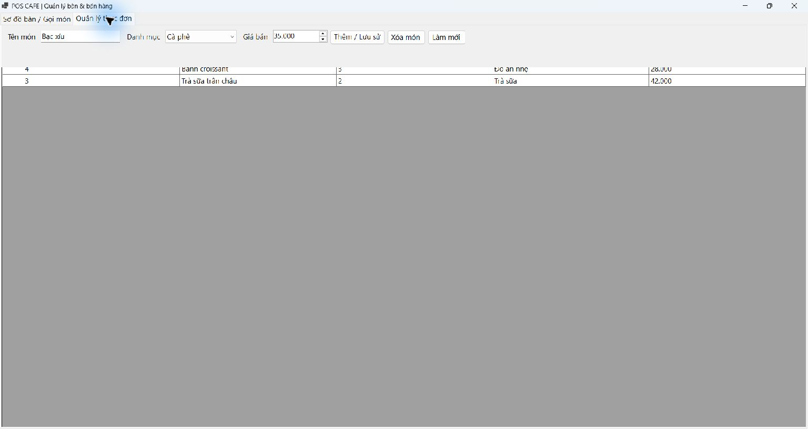
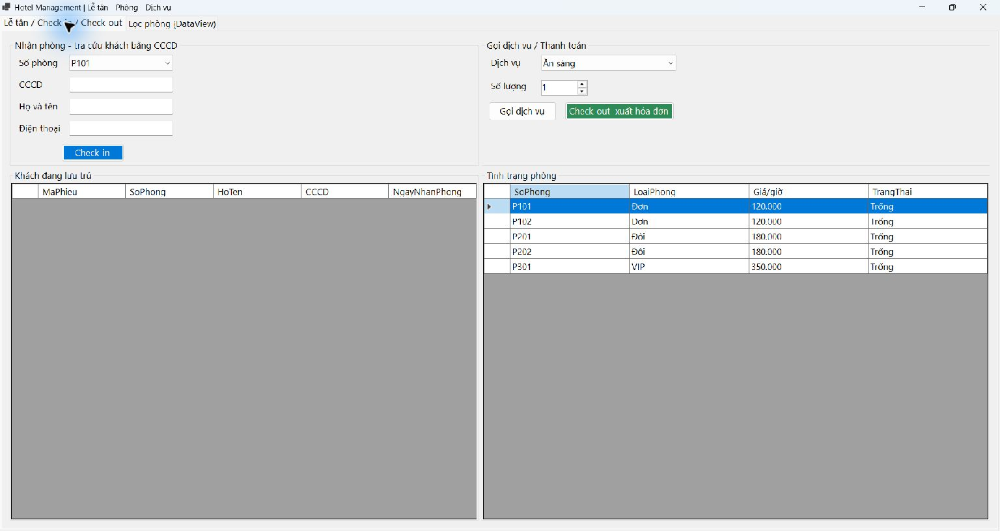
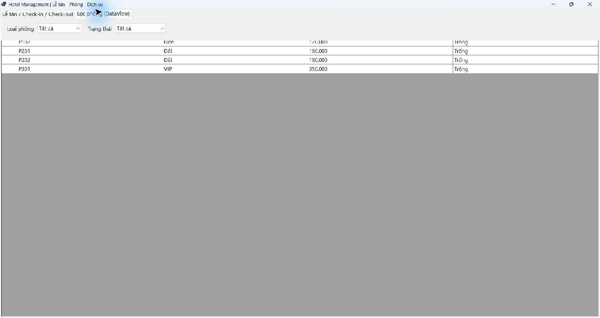
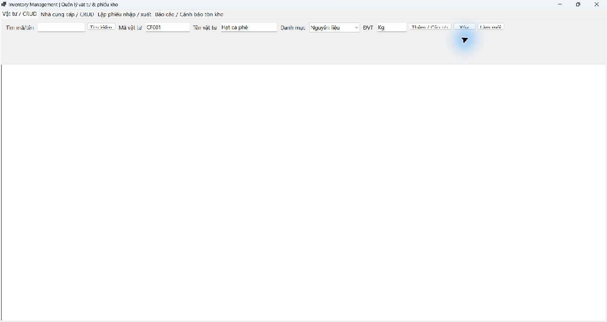
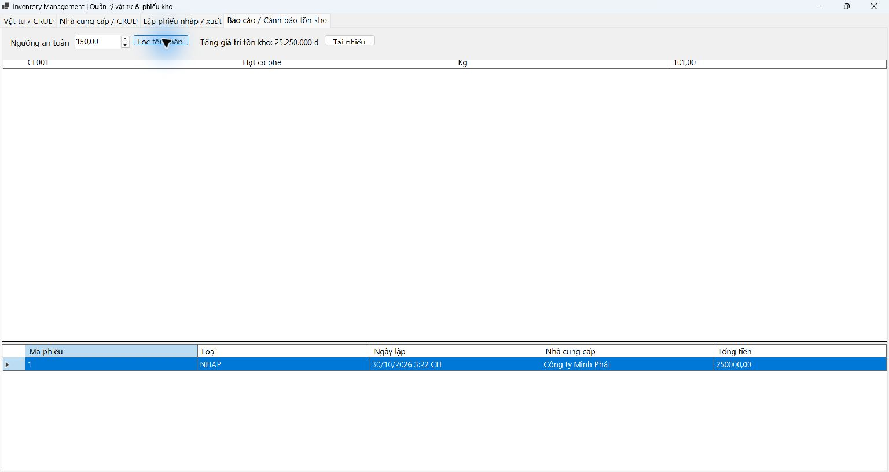

# LTNET – Bài tập 5.3, 5.4, 5.5

## Mục 1. Thông tin sinh viên

* **Họ và tên:** Lê Quang Hưng
* **Mã sinh viên:** 24810320237
* **Lớp:** D19QTANM1
* **Tên đề tài:** Hệ thống WinForms kết nối Microsoft SQL Server (Cafe POS, Khách sạn, Kho)

## Mục 2. Hướng dẫn cài đặt và chạy

1. Mở SQL Server Management Studio, kết nối `localhost\SQLEXPRESS` bằng Windows Authentication.
2. Chạy lần lượt `src/Database/CafePOSDB.sql`, `src/Database/HotelDB.sql` và `src/Database/InventoryDB.sql` để tạo ba database cùng dữ liệu mẫu.
3. Mở `src/LTNET-30-10-2026_24810320237_LeQuangHung.sln` bằng Visual Studio 2022.
4. Chọn project `CafePOS`, `HotelManagement` hoặc `InventoryManagement` làm Startup Project, sau đó nhấn F5.
5. Chuỗi kết nối hiện dùng Windows Authentication: `Server=localhost\SQLEXPRESS;Integrated Security=True;TrustServerCertificate=True`. Sửa chuỗi trong `DAL` của từng project nếu SQL Server của máy có tên instance khác.

## Mục 3. Ảnh kết quả

Ảnh chụp thực tế khi chạy ba ứng dụng được lưu trong `docs/`.

### Bài 5.3 — Cafe POS





### Bài 5.4 — Hotel Management





### Bài 5.5 — Inventory Management





Ảnh báo cáo kho ghi nhận một lần chạy thử lưu phiếu nhập 1 kg hạt cà phê, đơn giá 250.000 đ; dữ liệu tồn kho và phiếu kho được lưu trực tiếp trong SQL Server.

## Mục 4. Chức năng chính

### 5.3 Cafe POS

* Sơ đồ bàn bằng button động: bàn trống màu xanh, bàn đang có khách màu đỏ.
* Gọi món theo danh mục; danh sách món trên hóa đơn được nạp bằng `SqlDataAdapter` vào `DataTable`.
* Thanh toán trong `SqlTransaction`: chốt giờ ra, tổng tiền, trạng thái hóa đơn và giải phóng bàn đồng bộ.
* CRUD thực đơn có kiểm tra tên món và giá bán không âm.

### 5.4 Hotel Management

* Kiến trúc 3 tầng DTO–DAL–BUS–GUI.
* Check-in tra khách bằng CCCD có `SqlParameter`; thêm khách mới khi chưa có.
* Gọi dịch vụ trong thời gian lưu trú; checkout tính giờ phòng và dịch vụ trong `SqlTransaction`.
* Lọc loại phòng/trạng thái cục bộ bằng `DataView`.

### 5.5 Inventory Management

* CRUD vật tư và nhà cung cấp qua DAL/BUS; tìm kiếm vật tư dùng tham số SQL.
* Lưu phiếu nhập/xuất, chi tiết và biến động tồn kho trong một `SqlTransaction`.
* Phiếu xuất vượt tồn kho bị rollback và thông báo “Không đủ hàng trong kho”.
* Cảnh báo vật tư tồn dưới ngưỡng; tổng giá trị hàng tồn được tính bằng `ExecuteScalar`.

## Mục 5. Cấu trúc repository

```text
LTNET-30-10-2026_24810320237_LeQuangHung/
├── .gitignore
├── README.md
├── docs/                    # Ảnh chụp ứng dụng thực tế
└── src/                     # Solution và source code
    ├── Database/
    │   ├── CafePOSDB.sql
    │   ├── HotelDB.sql
    │   └── InventoryDB.sql
    ├── CafePOS/                 # Bài 5.3 — DTO, DAL, BUS, GUI
    ├── HotelManagement/         # Bài 5.4 — DTO, DAL, BUS, GUI
    ├── InventoryManagement/     # Bài 5.5 — DTO, DAL, BUS, GUI
    └── LTNET-30-10-2026_24810320237_LeQuangHung.sln
```
